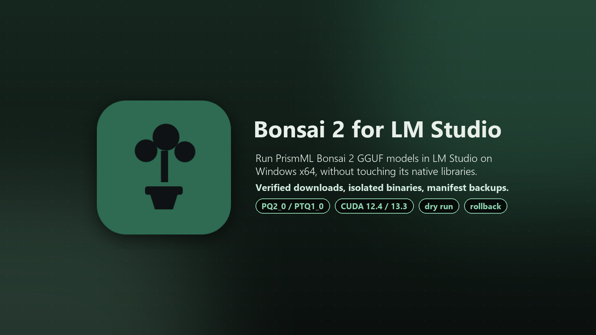
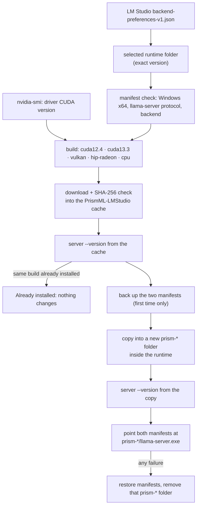

<div align="center">



[](https://github.com/SenjuWoo/bonsai2-lmstudio-fix/actions/workflows/test.yml)
[](https://github.com/SenjuWoo/bonsai2-lmstudio-fix/releases/latest)
[](tests/Test-Installer.ps1)
[](#install)
[](LICENSE)

**[Install](#install)** · **[Tour](#a-short-tour)** · **[Options](#options-and-behavior)** · **[Compatibility](#current-compatibility)** · **[Models](#models-and-backends)** · **[Rollback](#rollback)** · **[Changelog](CHANGELOG.md)**

</div>

Windows x64 installer for running PrismML Bonsai 2 GGUF models through LM Studio's llama-server
runtime. It installs PrismML's fork beside LM Studio's native libraries and changes the selected
runtime's server manifests, with backups and rollback on failure.

Stock runtimes can reject `PTQ1_0` / `PQ2_0` with `invalid ggml type 143/142`. Bonsai 2 also needs
its Hadamard/sign-flip transforms: recognizing a quantization format alone does not establish
compatibility. [PrismML's backend documentation](https://github.com/PrismML-Eng/Bonsai-demo/blob/main/BACKEND-SUPPORT.md)
currently requires its fork for all Bonsai 2 GGUF formats.

## What you get

- **Only the runtime you selected.** The exact llama.cpp version named in LM Studio's `backend-preferences-v1.json` is configured; other versions stay untouched.
- **The right build for your GPU.** CUDA 12.4 or 13.3 is picked from the driver's reported CUDA capability, and a build that does not match the runtime's backend is refused before anything is written.
- **Verified downloads.** PrismML archives are SHA-256 checked against pinned digests (or the release's own digests with `-Latest`) before extraction; a failed download never becomes a cached archive.
- **LM Studio's files left alone.** Fork binaries go into their own `prism-*` folder. LM Studio's root DLLs, Node bindings, executables, preferences and conversations are not modified.
- **Backups and automatic rollback.** The two server manifests are backed up once and kept across reruns; a failed update restores them and removes that attempt's folder.
- **A dry run first.** `-DryRun` shows the engine, build, cache and backup folders without writing anything.


## Install

1. Install [LM Studio](https://lmstudio.ai/download), download a Windows x64 llama.cpp runtime, and select it for GGUF models.
2. Unload models and close LM Studio. If you used this project's original DLL-swapping installer, re-download the selected runtime in LM Studio first to restore its native libraries.
3. [Download the installer ZIP](https://github.com/SenjuWoo/bonsai2-lmstudio-fix/releases/latest/download/bonsai2-lmstudio-fix-1.1.0.zip), extract it, and double-click `fix.bat`.
4. Restart LM Studio, load the model, and check generation.

The adjacent `install.ps1` is used when present. You can also [download just `fix.bat`](https://github.com/SenjuWoo/bonsai2-lmstudio-fix/releases/latest/download/fix.bat);
the v1.1.0 launcher fetches its matching release installer. [All releases and checksums](https://github.com/SenjuWoo/bonsai2-lmstudio-fix/releases/latest).
The historical v1.0.0 release remains the old DLL-swapping implementation.

Or download and run the current installer directly:

```powershell
Invoke-WebRequest https://raw.githubusercontent.com/SenjuWoo/bonsai2-lmstudio-fix/main/install.ps1 -UseBasicParsing -OutFile install.ps1
powershell -NoProfile -ExecutionPolicy Bypass -File .\install.ps1
```

## A short tour

From the extracted folder, in PowerShell:

```powershell
.\install.ps1 -DryRun                    # what would change: engine, build, cache, backup folders
.\install.ps1                            # auto-select CUDA 12.4 / 13.3 / Vulkan / HIP / CPU from the runtime
.\install.ps1 -Asset cuda12.4            # keep CUDA 12 explicitly
.\install.ps1 -Latest -DryRun            # newest stable PrismML release, digests from GitHub
.\install.ps1 -EngineDir <runtime folder> # patch one runtime folder only
```

## Options and behavior

```text
.\install.ps1 [-DryRun] [-Asset cuda12.4|cuda13.3|vulkan|hip-radeon|cpu]
              [-Latest] [-SourceDir <folder>] [-EngineDir <folder>]
              [-LMStudioHome <folder>] [-CacheDir <folder>] [-BackupDir <folder>] [-Force]
```

| Option | Does |
|---|---|
| `-DryRun` | Validate the selection and show destinations without writing. `-Latest` still performs a metadata lookup. `PRISM_DRYRUN=1` does the same. |
| `-Asset` | Choose the PrismML build. Default: picked from the runtime's backend and, for CUDA, the driver's reported CUDA version. |
| `-Latest` | Discover the newest stable PrismML GitHub release; requires matching Windows assets with SHA-256 digests. The default stays on the verified release pin. |
| `-LMStudioHome` / `LMSTUDIO_HOME` | Override `%USERPROFILE%\.lmstudio`. |
| `-EngineDir` | Explicitly choose one runtime; its manifests must use the Windows x64 llama-server protocol. |
| `-SourceDir` | Use one extracted build, including its required DLLs; local binaries are trusted as supplied and labeled as a local build. |
| `-CacheDir` / `-BackupDir` | Download cache (default `%LOCALAPPDATA%\PrismML-LMStudio`) and manifest backups (default `<cache>\backup`). |
| `-Force` | Download/extract the selected release again. Cached archives are SHA-256 checked before extraction. |

Only the **exact selected version** from `backend-preferences-v1.json` is configured. Unselected
versions remain untouched. Mixed backend selections fail with instructions to choose one engine
explicitly. Unsupported/older native protocols fail before engine changes.

Downloads are cached per release/backend under `%LOCALAPPDATA%\PrismML-LMStudio`. Fork binaries are
copied into their own `prism-*` directory and referenced by the two server manifests; LM Studio's
root DLLs, Node bindings, executables, preferences, and conversations remain untouched. Identical
reruns reuse the installed binaries. Changed builds retain their previous directory for rollback.

Allow several GB for CUDA archive downloads, extraction, and an installed runtime copy. Failed
downloads never become final cached ZIPs. Source and copied server startup are checked before
manifests change; metadata write failures restore the previous manifests and remove that attempt's
directory. `--version` is a startup check, not proof of generation or complete LM Studio integration.

After LM Studio replaces or updates the selected inference runtime, rerun the installer.
Startup/model failures return an error through the batch launcher.

## How it works



## Current compatibility

Upstream checked **2026-10-02**:

| Component | Current baseline |
|---|---|
| LM Studio stable | [0.4.25](https://lmstudio.ai/download) |
| Runtime manifests inspected | Windows x64 llama.cpp 2.50.0, using the llama-server protocol |
| PrismML release pin | [`prism-b10743-adfffbe`](https://github.com/PrismML-Eng/llama.cpp/releases/tag/prism-b10743-adfffbe), published 2026-09-25 |
| Windows x64 CUDA packages | CUDA **12.4** and **13.3**, including their runtime DLL bundles |
| CUDA Toolkit latest | [13.4 Update 1](https://docs.nvidia.com/cuda/cuda-toolkit-release-notes/index.html); installing the Toolkit is unnecessary for these prebuilt packages |

Auto-selection uses the selected runtime's backend and the driver's maximum CUDA version reported by
`nvidia-smi`. It chooses CUDA 13.3 when the driver reports at least 13.3, otherwise CUDA 12.4.
`-Asset cuda12.4` explicitly keeps CUDA 12. The driver-reported version is not the installed Toolkit
version. An older driver is rejected when its reported capability is below the requested build.

PrismML does not currently publish a Windows x64 CUDA 12.8 package in this release. Newer GPUs,
including RTX 50-series, may need newer kernels than CUDA 12.4 provides; use a compatible CUDA 13.3
driver/build or an appropriate source build. Do not infer GPU support from the LM Studio runtime name.

`-Latest` discovers the newest stable PrismML GitHub release and requires matching Windows assets
with SHA-256 digests. The default stays on the verified release pin. Future binaries still need
model-generation checks; upstream releases do not guarantee LM Studio protocol compatibility.

## Models and backends

The current official family is [Ternary-Bonsai-2-27B-gguf](https://huggingface.co/prism-ml/Ternary-Bonsai-2-27B-gguf).
The installer does not download or alter models.

| Model format | Guidance |
|---|---|
| Bonsai 2 `PQ2_0` / `PTQ1_0` | Use PrismML's fork. CUDA / CPU / HIP implement both formats; hardware validation varies. |
| Bonsai 2 development `Q2_0` | Also needs the fork's transforms. Stock loading can succeed while generating incorrect output. [Development model](https://huggingface.co/prism-ml/Ternary-Bonsai-2-27B-gguf-dev). |
| Earlier Bonsai `Q1_0` | Now broadly supported in mainline; this workaround is not universally necessary. |
| Earlier ternary legacy `Q2_0` | Old group-128 files are incompatible with modern group-64 readers. Download the current `_g64` / `PQ2_0` variant. [Format guide](https://github.com/PrismML-Eng/Bonsai-demo/blob/main/MODEL-FORMATS.md). |

Vulkan has **no native PQ2_0 kernels** in the documented baseline. Use PTQ1_0 or a backend
implementing PQ2_0. Vulkan PTQ1_0 and transforms have device-specific limitations; HIP also needs
validation on the target AMD GPU. Consult the [upstream matrix](https://github.com/PrismML-Eng/Bonsai-demo/blob/main/BACKEND-SUPPORT.md),
whose source audit is pinned to an earlier release. Windows GPU execution here is verified only on NVIDIA.

For vision, use the matching model projector; installing a runtime does not establish LM Studio
vision or reasoning-control integration. This installer does not add a reasoning-effort selector or
modify chat templates.

## Rollback

With LM Studio closed, restore `backend-manifest.json` and `engine-protocol-server-artifacts.json`
from `%LOCALAPPDATA%\PrismML-LMStudio\backup\<engine folder>\` to that engine folder, or re-download
the runtime in LM Studio. Original backups are preserved across reruns. A failed update
automatically restores the manifests active immediately before that attempt.

After restoring stock manifests, obsolete `prism-*` directories created by this installer can be
removed to reclaim space. For a machine previously patched with v1.0.0, manifest restoration alone
does not undo the old root-level DLL swap; restore its complete original backup or re-download the runtime.

## Verification

Run the offline regression checks with either shell:

```powershell
powershell -NoProfile -ExecutionPolicy Bypass -File .\tests\Test-Installer.ps1
pwsh -NoProfile -File .\tests\Test-Installer.ps1
```


Checks cover runtime selection, no-write dry runs, backend mismatch, failed server startup, metadata
rollback, stock DLL preservation, backup retention, reruns, corrupt archives, and launcher exit codes.
GitHub Actions runs both shells on every push and pull request. See [VALIDATION.md](VALIDATION.md)
for the separate package, model-generation, and LM Studio integration evidence.

MIT License for this installer. PrismML's llama.cpp fork is a separate upstream project with its own
licensing. Not affiliated with LM Studio or PrismML.
